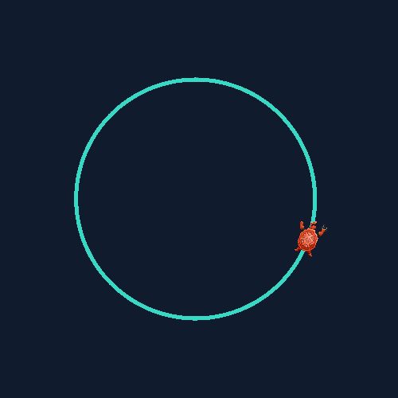
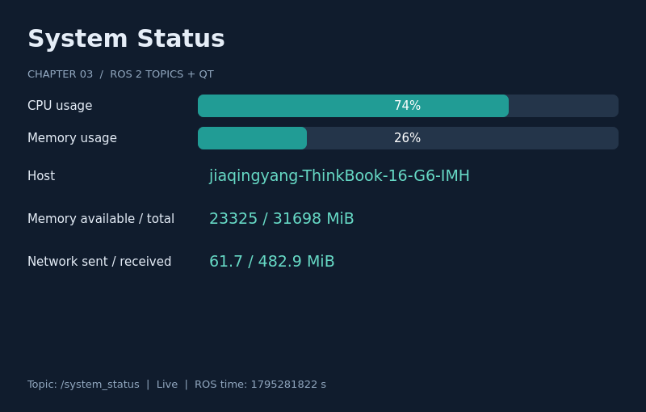
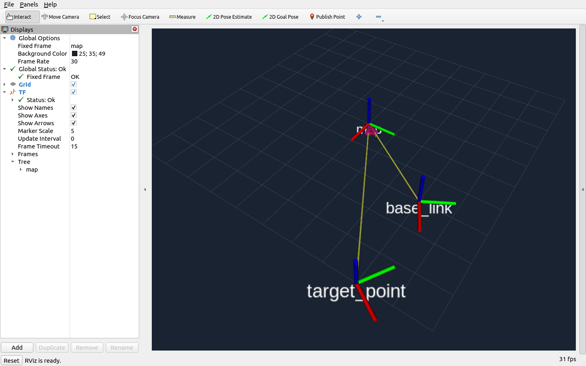
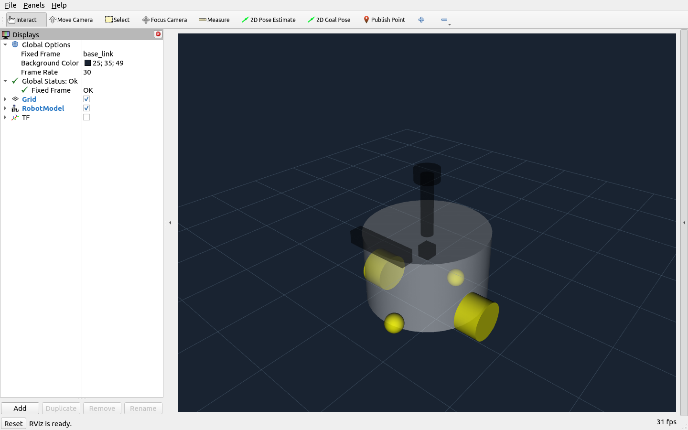
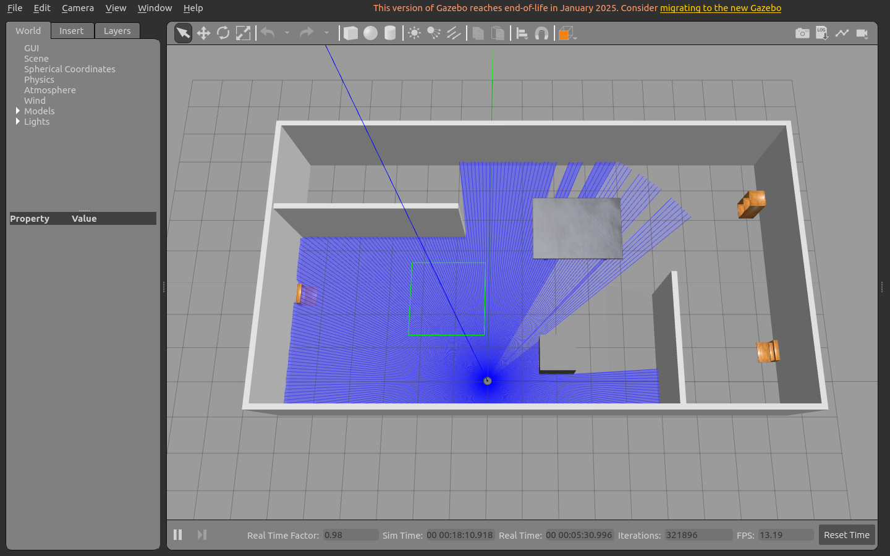
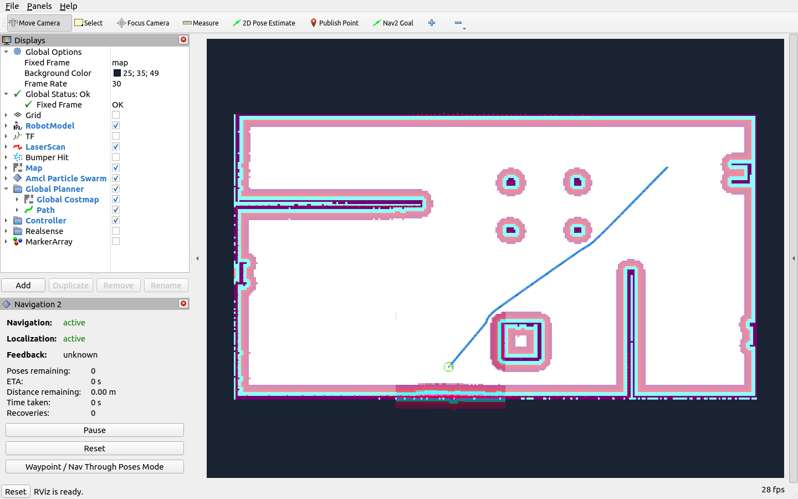

# FishROS Learning Journey
Learning is still going on...

---

A personal learning repository documenting my progress through FishROS and ROS 2, from basic C++ and Python nodes to robot simulation and navigation.

The chapter folders contain exercises, experiments, and incremental changes made while learning. The screenshots below show examples actually running from these workspaces.

**Environment:** ROS 2 Humble, C++, Python, Qt 5, RViz 2, Gazebo Classic, and Nav2.

## Learning Progress

| Folder | Topics explored |
| --- | --- |
| `chapt1` | C++ and Python basics, CMake, and first programs |
| `chapt2` | ROS 2 nodes, packages, classes, and threading |
| `chapt3` | Publishers and subscribers, custom messages, Turtlesim control, and a Qt status display |
| `chapt4` | Services, parameters, launch files, turtle patrol, and face detection experiments |
| `chapt5` | Static and dynamic TF broadcasters, transform listeners, and RViz |
| `chapt6` | URDF/Xacro robot modeling, sensors, Gazebo, and ros2_control |
| `chapt7` | SLAM, saved maps, localization, Nav2, waypoints, and patrol applications |
| `chapt8` | Pluginlib and custom Nav2 planner and controller experiments |
| `chapt10` | Executors, callback scheduling, and QoS reliability in Python and C++ |

## Visual Highlights

### Topic-Based Turtle Control · Chapter 3



A C++ publisher sends velocity commands to Turtlesim and draws a circular trajectory.

### Live System Status · Chapter 3



A Qt interface displays live CPU, memory, and network statistics received through a custom ROS 2 topic.

### Coordinate Transforms · Chapter 5



RViz shows the relationships between the `map`, `base_link`, and `target_point` coordinate frames.

### FishBot Robot Model · Chapter 6



The FishBot URDF/Xacro model brings together the robot body, wheels, caster supports, and sensors in RViz.

### Indoor Simulation · Chapter 7



FishBot runs in a furnished Gazebo room with visible simulated laser rays.

### Map and Path Planning · Chapter 7



Nav2 computes a path around obstacles on the saved room map, with localization and costmaps visible in RViz.

## Workspace Notes

Each chapter workspace is built and sourced independently because several chapters reuse package names as the examples evolve. For example, to display the Chapter 6 robot model from the repository root:

```bash
source /opt/ros/humble/setup.bash
cd chapt6/chapt6_ws
colcon build --symlink-install
source install/local_setup.bash
ros2 launch fishbot_description display_robot.launch.py
```

Use a fresh terminal when switching chapters. The Chapter 10 executor and QoS examples primarily produce terminal output.

The images are stored in `pictures/`; local reference materials and generated workspace files are excluded through `.gitignore`.
